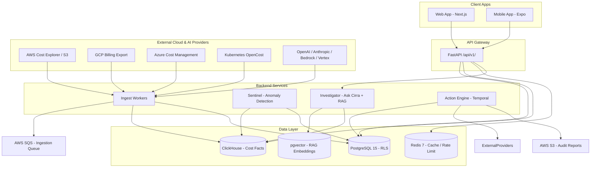
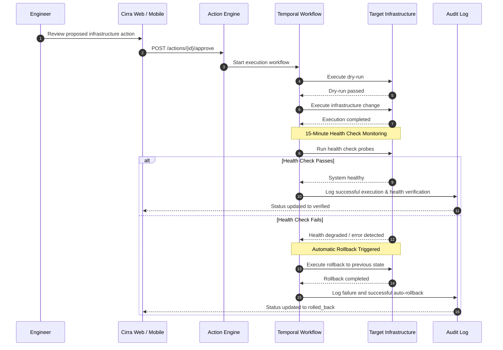
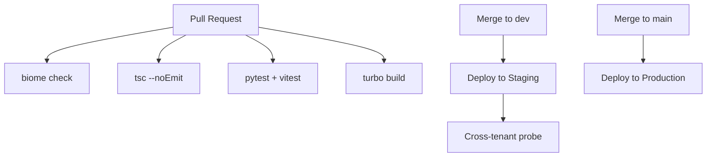

# Cirra
[](https://opensource.org/licenses/MIT)
[](https://pnpm.io/)
[](https://nodejs.org/)
[](https://www.python.org/)
[](https://nextjs.org/)
[](https://fastapi.tiangolo.com/)
[.svg)](https://turborepo.com)

> **See it. Guard it. Act on it. Prove it.**

---

## What is Cirra?

Cirra is a multi-tenant B2B SaaS platform that gives engineering and finance teams one unified place to see every dollar spent on AWS, GCP, Azure, Kubernetes, OpenAI, Anthropic, Bedrock, and Vertex AI — detect waste in real time, fix it through human-approved actions, and prove the savings in an auditable ledger.

Historically, engineering teams discover cloud and AI waste weeks after the bill arrives, while finance teams struggle to attribute runaway LLM token costs or cloud instance sprawl to specific customer tenants or product features. Cirra solves this fragmentation by combining automated FOCUS-normalized ingestion, statistical anomaly detection, deterministic query aggregation, and a rigorous human-in-the-loop safety workflow.

Cirra is built around four core product pillars: **SEE** (unified dashboards, allocation by team/customer/feature, AI cost breakdown, tag governance), **GUARD** (budgets, anomaly detection, spend caps, kill switches, leaked-key detection, mobile approvals), **ACT** (rightsizing, idle cleanup, cost-in-PR comments, Action Center with approval, dry-run, and rollback), and **PROVE** (Savings Ledger comparing realized spend against baseline counterfactuals, AI margin per customer, weekly CFO digest).

### Personas

| Persona | Role | Primary need |
| :--- | :--- | :--- |
| **Priya** | Head of Platform / DevOps | See spend by team, act on waste |
| **Arjun** | CTO / VP Engineering | Explain the AI bill, cap runaway spend |
| **Meera** | CFO / Finance lead | Margin per customer, proven savings |
| **Sam** | On-call Engineer | Approve a fix or kill a runaway job at 2 a.m. |

---

## System Architecture Diagram

### Diagram A — High-Level System Overview



### Diagram B — Action Lifecycle (Human-Approval Safety Loop)



---

## Monorepo Structure

```text
cirra/
├── apps/
│   ├── web/                  # Next.js 14 App Router — main dashboard
│   ├── mobile/               # React Native + Expo — alerts + kill switch
│   └── docs/                 # Nextra docs site
├── packages/
│   ├── ui/                   # Shared component library (shadcn/ui + Cirra tokens)
│   ├── types/                # Shared TypeScript types (FOCUS schema, API contracts)
│   ├── utils/                # Formatters, constants, helpers
│   └── config/               # Biome, TypeScript tsconfig base
├── services/
│   ├── api/                  # FastAPI — main API (auth, RBAC, query layer)
│   ├── ingest/               # Python connectors + FOCUS normalizer workers
│   ├── sentinel/             # Anomaly detection (ARIMA + MAD, no LLM)
│   ├── investigator/         # Ask Cirra (text-to-SQL + RAG) + anomaly explainer
│   └── action-engine/        # Temporal workflows (dry-run → approve → execute → rollback)
├── infra/
│   ├── terraform/            # AWS infra-as-code
│   ├── helm/                 # Kubernetes Helm charts (Private mode)
│   └── docker/               # Dockerfiles + init scripts
├── scripts/
│   ├── audit/                # Standalone free audit CLI (no DB needed)
│   └── seed/                 # Demo data seeder
├── .github/workflows/        # CI (lint + test + build) and CD (deploy)
├── turbo.json                # Turborepo task pipeline configuration
├── pnpm-workspace.yaml       # pnpm workspace definition
├── docker-compose.yml        # Full local dev stack
└── .env.example              # Environment variables template
```

---

## Key Design Principles

1. **Read-only by default** — Write access is opt-in, scoped per action, human-approved.
2. **LLM never produces a cost number** — All numbers come from deterministic ClickHouse queries only.
3. **LLM never executes actions** — It proposes; a human approves every infrastructure change.
4. **Detection is statistical, not AI** — Sentinel uses ARIMA + MAD scoring. LLMs explain anomalies, never detect them.
5. **Every write follows the safety loop** — dry-run → approval → execute → health check → auto-rollback → audit log.
6. **Tenant isolation at two layers** — Postgres Row Level Security + explicit tenant_id filter in every query.
7. **Secrets never in code** — All credentials via Doppler / Railway secrets manager.

---

## MVP Roadmap

| MVP | Name | Timeline | What Ships | Status |
| :---: | :--- | :---: | :--- | :---: |
| **0** | Free Audit Script | Week 1–2 | Standalone CLI: top 10 waste items, AI spend by key, untagged %, HTML + PDF report | 🔨 Building |
| **1** | Cirra Lens | Weeks 1–10 | Auth, connections (AWS/GCP/AI), ingestion, FOCUS normalization, dashboard, cloud + AI spend views, Ask Cirra, audit report | 🔨 Building |
| **2** | Cirra Guard | Months 3–5 | Anomaly detection, budgets, spend caps, kill switch, leaked-key detection, Slack bot, mobile app | 📋 Planned |
| **3** | Cirra Private + Margin | Months 6–9 | Action Center, Temporal workflows, Savings Ledger, Stripe margin, Gateway service, Private mode Helm chart | 📋 Planned |

---

## Prerequisites

Ensure you have the following tools installed before getting started:

* [Node.js 20+](https://nodejs.org)
* [pnpm 9+](https://npmjs.com) (`npm install -g pnpm@9`)
* [Python 3.11+](https://www.python.org)
* [Docker Desktop](https://www.docker.com)
* Git 2.40+

*Optional:*
* AWS CLI v2 (for Cost Explorer connector testing)
* `openssl` (to generate `ENCRYPTION_KEY`)

---

## Local Development Setup

### 9.1 Clone and install

```bash
git clone https://github.com/your-org/cirra
cd cirra
pnpm install
```

### 9.2 Environment variables

```bash
cp .env.example .env.local
# Fill in values — minimum for local dev:
# SUPABASE_URL, SUPABASE_ANON_KEY, SUPABASE_SERVICE_ROLE_KEY
# CLICKHOUSE_HOST, CLICKHOUSE_PASSWORD
# REDIS_URL
# NEXTAUTH_SECRET (any random string locally)
# OPENAI_API_KEY
# ENCRYPTION_KEY (generate: openssl rand -base64 32)
```

### 9.3 Start infrastructure

```bash
docker compose up -d
# Starts: Postgres 15, ClickHouse 24, Redis 7
# Wait ~15s for health checks to pass
docker compose ps   # all should show "healthy"
```

### 9.4 Run database migrations

```bash
cd services/api
pip install -e ".[dev]"
alembic upgrade head
cd ../..
```

### 9.5 Start all apps

```bash
pnpm dev
# Turborepo starts concurrently:
#   apps/web        → http://localhost:3000
#   services/api    → http://localhost:8000
#   services/ingest → Celery worker (no port)
```

### 9.6 Verify

```bash
curl http://localhost:8000/health
# → {"status":"ok","version":"0.1.0"}
```

Open `http://localhost:3000` — you should see the Cirra sign-in screen.

### 9.7 Run the free audit script (standalone, no DB)

```bash
cd scripts/audit
pip install -r requirements.txt
python cli.py --aws-role-arn arn:aws:iam::123456789:role/CirraReadOnly --openai-key sk-...
# Outputs: audit_report.html + console summary
```

---

## API Documentation

* **Base URL:** `https://api.cirra.dev/api/v1/` (prod) · `http://localhost:8000/api/v1/` (local)
* **Auth:** All endpoints require `Authorization: Bearer <jwt>`. Exchange a Supabase session token at `POST /auth/session`.
* **Interactive Docs:** `http://localhost:8000/docs` (Swagger UI) · `http://localhost:8000/redoc` (ReDoc)

### API Reference Table

| Method | Path | Auth | Role | Description |
| :--- | :--- | :---: | :---: | :--- |
| `POST` | `/auth/session` | Supabase token | Any | Exchange Supabase JWT for Cirra JWT |
| `GET` | `/dashboard/summary` | Bearer | Any | Headline spend, waste estimate, coverage score |
| `GET` | `/spend/cloud` | Bearer | Any | Cloud cost breakdown with filters (provider, service, region, team, date range) |
| `GET` | `/spend/ai` | Bearer | Any | AI usage breakdown by provider, model, key, team, customer |
| `POST` | `/ask` | Bearer | Any | Ask Cirra natural language question → SQL + answer |
| `GET` | `/connections` | Bearer | Any | List all provider connections and their sync status |
| `POST` | `/connections` | Bearer | Admin/Owner | Add a new cloud or AI provider connection |
| `GET` | `/connections/{id}/test` | Bearer | Admin/Owner | Test connection credentials (read-only ping) |
| `DELETE` | `/connections/{id}` | Bearer | Owner | Remove a connection and its data |
| `GET` | `/allocation/rules` | Bearer | Any | List allocation rules ordered by priority |
| `POST` | `/allocation/rules` | Bearer | Admin/Owner | Create a new allocation rule |
| `PATCH` | `/allocation/rules/{id}` | Bearer | Admin/Owner | Update a rule |
| `DELETE` | `/allocation/rules/{id}` | Bearer | Admin/Owner | Delete a rule |
| `GET` | `/allocation/coverage` | Bearer | Any | % of spend attributed and breakdown by method |
| `GET` | `/anomalies` | Bearer | Any | List open anomalies (MVP 2) |
| `POST` | `/anomalies/{id}/dismiss` | Bearer | Admin/Owner | Dismiss an anomaly (MVP 2) |
| `GET` | `/budgets` | Bearer | Any | List all budgets and burn-rate status (MVP 2) |
| `POST` | `/budgets` | Bearer | Admin/Owner | Create a budget with alert thresholds (MVP 2) |
| `GET` | `/actions` | Bearer | Any | List proposed and executed actions (MVP 3) |
| `POST` | `/actions` | Bearer | Admin/Owner | Propose a new infrastructure action (MVP 3) |
| `POST` | `/actions/{id}/approve` | Bearer | Admin/Owner | Approve and trigger action execution (MVP 3) |
| `POST` | `/actions/{id}/rollback` | Bearer | Admin/Owner | Manually trigger rollback of an executed action (MVP 3) |
| `GET` | `/savings` | Bearer | Any | Savings Ledger — identified, approved, verified, realized totals (MVP 3) |
| `POST` | `/audit` | Bearer | Any | Trigger free audit report generation → returns PDF download URL |
| `GET` | `/settings/team` | Bearer | Any | List team members and roles |
| `POST` | `/settings/team/invite` | Bearer | Owner | Invite a new team member |
| `DELETE` | `/settings/team/{userId}` | Bearer | Owner | Remove a team member |

### Example Request / Response (`POST /ask`)

```bash
curl -X POST https://api.cirra.dev/api/v1/ask \
  -H "Authorization: Bearer <token>" \
  -H "Content-Type: application/json" \
  -d '{"question": "Why did our OpenAI spend spike on Tuesday?"}'
```

```json
{
  "answer": "OpenAI spend on Tuesday 15 Oct was $847, up 340% vs the 7-day average of $193. The spike came from api_key_id 'key_prod_gpt4', model 'gpt-4o', between 14:00–18:00 UTC. Team tag: 'backend-search'. 2.1M tokens were consumed in that window.",
  "sql": "SELECT sum(cost_usd), model, api_key_id FROM ai_usage_facts WHERE tenant_id = '...' AND ts BETWEEN '2024-10-15 00:00:00' AND '2024-10-15 23:59:59' GROUP BY model, api_key_id ORDER BY sum(cost_usd) DESC LIMIT 1000",
  "rows": [
    { "sum(cost_usd)": 847.23, "model": "gpt-4o", "api_key_id": "key_prod_gpt4" }
  ],
  "confidence": 0.91,
  "warning": null
}
```

### Error Format

```json
{
  "code": "TENANT_NOT_FOUND",
  "message": "No tenant found for the provided token",
  "details": {}
}
```

---

## Data Model

### PostgreSQL (Metadata, Auth, RBAC)

| Table | Description |
| :--- | :--- |
| `tenants` | One row per customer account |
| `users` | Users scoped to a tenant via RLS |
| `api_keys` | Hashed API keys with scopes per tenant |
| `connections` | Encrypted cloud/AI provider credentials per tenant |
| `allocation_rules` | Priority-ordered tag/account/naming rules for spend attribution |
| `anomalies` | Detected spend anomalies with explanation and status |
| `budgets` | Budget definitions with alert thresholds and burn-rate tracking |
| `actions` | Full audit trail for every proposed and executed infrastructure action |
| `savings_entries` | Verified savings with baseline, method, and realized cost |
| `knowledge_chunks` | RAG document chunks with pgvector embeddings per tenant |

### ClickHouse (Append-Only Cost Facts)

```sql
CREATE TABLE default.cost_facts (
    tenant_id LowCardinality(String),
    charge_period_start DateTime,
    charge_period_end DateTime,
    provider LowCardinality(String),
    service_name String,
    resource_id String,
    sku_id String,
    billed_cost Decimal(18, 4),
    effective_cost Decimal(18, 4),
    currency LowCardinality(String),
    tags Map(String, String),
    allocated_team LowCardinality(String),
    allocated_customer LowCardinality(String),
    allocated_feature LowCardinality(String),
    allocation_method LowCardinality(String),
    inserted_at DateTime DEFAULT now()
) ENGINE = MergeTree()
PARTITION BY toYYYYMM(charge_period_start)
ORDER BY (tenant_id, provider, service_name, charge_period_start);

CREATE TABLE default.ai_usage_facts (
    tenant_id LowCardinality(String),
    ts DateTime,
    provider LowCardinality(String),
    model LowCardinality(String),
    api_key_id String,
    input_tokens UInt64,
    output_tokens UInt64,
    cost_usd Decimal(18, 6),
    team_tag LowCardinality(String),
    customer_tag LowCardinality(String),
    feature_tag LowCardinality(String),
    inserted_at DateTime DEFAULT now()
) ENGINE = MergeTree()
PARTITION BY toYYYYMM(ts)
ORDER BY (tenant_id, provider, model, ts);
```

### FOCUS Normalization Mapping

| FOCUS Field | AWS (Cost Explorer) | GCP (Billing Export) | OpenAI (Usage API) |
| :--- | :--- | :--- | :--- |
| `service_name` | `ProductName` | `service.description` | `"OpenAI"` |
| `resource_id` | `ResourceId` | `resource.name` | `api_key_id` |
| `billed_cost` | `UnblendedCost` | `cost` | `total_cost` |
| `charge_period_start` | `TimePeriod.Start` | `usage_start_time` | `timestamp` |
| `tags` | `Tags` map | `labels` map | `{team, customer, feature}` |

---

## Sample Dataset

Cirra includes mock seeding utilities for local development and demonstration.

* **Seed Tenant:** `demo@cirra.dev` / `cirra_demo_2024`

### ClickHouse Sample Rows

| tenant_id | charge_period_start | provider | service_name | resource_id | billed_cost | allocated_team | allocation_method |
| :--- | :--- | :--- | :--- | :--- | :---: | :--- | :--- |
| demo-tenant-001 | 2024-10-01 | aws | EC2 | i-0abc123def | 842.50 | backend | tag |
| demo-tenant-001 | 2024-10-01 | aws | S3 | arn:aws:s3:::cirra-data | 23.17 | platform | rule |
| demo-tenant-001 | 2024-10-01 | gcp | BigQuery | projects/demo/datasets/analytics | 156.00 | data | tag |
| demo-tenant-001 | 2024-10-01 | openai | GPT-4o | key_prod_gpt4 | 847.23 | backend-search | tag |
| demo-tenant-001 | 2024-10-01 | aws | RDS | db-prod-postgres-01 | 312.40 | null | unallocated |

### Seed Script Usage

```bash
cd scripts/seed
python seed_db.py          # creates demo tenant + users in Postgres
python seed_clickhouse.py  # inserts 1,000 FOCUS cost rows into ClickHouse
```

The seed generates 90 days of realistic cost data with:
* 6 AWS services (EC2, RDS, S3, Lambda, ECS, CloudFront)
* 2 GCP services (BigQuery, Cloud Run)
* 3 AI providers (OpenAI gpt-4o, Anthropic claude-3-5-sonnet, Bedrock titan-embed)
* 30% unallocated spend to demonstrate the allocation feature
* One simulated anomaly spike on day 60 (3× normal OpenAI usage) to demo Sentinel

---

## Testing

### Test Structure

| Layer | Framework | Location | What’s tested |
| :--- | :--- | :--- | :--- |
| Frontend unit | Vitest + Testing Library | `apps/web/__tests__/` | Component rendering, TanStack Query hooks |
| Frontend E2E | Playwright | `apps/web/e2e/` | Full user flows: sign-up → connect → dashboard → ask |
| API unit | pytest | `services/api/tests/` | Route handlers, RBAC, JWT validation |
| API integration | pytest + testcontainers | `services/api/tests/integration/` | Postgres RLS, ClickHouse queries with real containers |
| Ingest unit | pytest | `services/ingest/tests/` | FOCUS normalizer field mapping, dedup logic |
| Sentinel unit | pytest | `services/sentinel/tests/` | Anomaly detection on synthetic time-series |
| Cross-tenant security | pytest | `services/api/tests/security/` | Assert tenant A cannot read tenant B data |

### Running Tests

```bash
# All tests (Turborepo runs only affected)
pnpm test

# Frontend only
cd apps/web && pnpm test

# Backend only
cd services/api && pytest -v

# Cross-tenant security probe (critical — run before every deploy)
cd services/api && pytest tests/security/ -v

# E2E (requires running local stack)
cd apps/web && pnpm exec playwright test
```

### Critical Test: Cross-Tenant Isolation

```python
# services/api/tests/security/test_tenant_isolation.py
async def test_tenant_a_cannot_read_tenant_b_spend():
    # Creates two tenants, inserts cost rows for each,
    # authenticates as tenant A, asserts GET /spend/cloud
    # returns only tenant A rows with zero leakage.
    pass
```

### Performance Benchmarks

| Query | Target p95 | Method |
| :--- | :---: | :--- |
| `GET /dashboard/summary` (30-day, 100K rows) | < 500ms | ClickHouse aggregation |
| `GET /spend/cloud` with filters | < 500ms | ClickHouse with tenant + date index |
| `POST /ask` (text-to-SQL + execute) | < 3s | LLM call + ClickHouse query |
| Dashboard initial load (web) | < 2s | Next.js SSR + TanStack Query prefetch |

---

## Deployment

### 14.1 Cloud Mode (Cirra Cloud — Production)

| Service | Platform | Command |
| :--- | :--- | :--- |
| `apps/web` | Vercel | Auto-deploy on push to main via GitHub integration |
| `services/api` | Railway | `railway up` from `services/api/` |
| `services/ingest` | Railway | `railway up` from `services/ingest/` |
| `services/sentinel` | Railway | `railway up` from `services/sentinel/` |
| `services/investigator` | Railway | `railway up` from `services/investigator/` |
| PostgreSQL | Supabase | Managed — configure via Supabase dashboard |
| ClickHouse | ClickHouse Cloud | Managed — free tier for MVP |
| Redis | Upstash | Managed serverless — free tier for MVP |
| Object storage | AWS S3 | `aws s3 mb s3://cirra-audit-reports` |
| Queue | AWS SQS | Terraform provisioned |

#### Pre-deploy Checklist

* [ ] All secrets set in Railway / Doppler (never in `.env` committed to repo)
* [ ] `ENCRYPTION_KEY` set (32-byte base64, never rotated after first deploy)
* [ ] Supabase RLS policies applied (`alembic upgrade head`)
* [ ] Cross-tenant security test passes
* [ ] `NEXTAUTH_URL` set to production domain
* [ ] ClickHouse read-only user created for Investigator service

#### First Deploy Steps

```bash
# 1. Set up Supabase project and run migrations
cd services/api && alembic upgrade head

# 2. Deploy web to Vercel
cd apps/web && vercel deploy --prod

# 3. Deploy backend services to Railway
cd services/api && railway up
cd services/ingest && railway up

# 4. Verify health
curl https://api.cirra.dev/health
```

### 14.2 Private Mode (Self-Hosted in Customer VPC)

```bash
# Prerequisites: Kubernetes cluster, Helm 3, kubectl

# Add Cirra Helm repo
helm repo add cirra https://charts.cirra.dev
helm repo update

# Install with values file
helm install cirra cirra/cirra \
  --namespace cirra \
  --create-namespace \
  --values ./infra/helm/values.private.yaml

# values.private.yaml must set:
# - llm.provider: ollama
# - llm.model: sqlcoder:7b
# - embeddings.model: nomic-embed-text
# - db.postgres.url: <internal cluster URL>
# - db.clickhouse.url: <internal cluster URL>
```

### 14.3 CI/CD Pipeline



---

## Environment Variables Reference

| Variable | Required | Purpose | How to get |
| :--- | :---: | :--- | :--- |
| `SUPABASE_URL` | ✅ | Supabase project URL | Supabase dashboard → Settings → API |
| `SUPABASE_ANON_KEY` | ✅ | Public anon key | Supabase dashboard → Settings → API |
| `SUPABASE_SERVICE_ROLE_KEY` | ✅ | Admin key for migrations | Supabase dashboard → Settings → API |
| `CLICKHOUSE_HOST` | ✅ | ClickHouse Cloud hostname | ClickHouse Cloud → Connect |
| `CLICKHOUSE_PASSWORD` | ✅ | ClickHouse password | ClickHouse Cloud → Connect |
| `REDIS_URL` | ✅ | Upstash Redis URL | Upstash dashboard → Database → Details |
| `OPENAI_API_KEY` | ✅ | For Ask Cirra (Investigator) | `platform.openai.com` |
| `ANTHROPIC_API_KEY` | ⬜ | For Anthropic-hosted Ask Cirra | `console.anthropic.com` |
| `ENCRYPTION_KEY` | ✅ | AES-256 key for stored credentials | `openssl rand -base64 32` |
| `NEXTAUTH_SECRET` | ✅ | Next-auth session signing | `openssl rand -base64 32` |
| `NEXTAUTH_URL` | ✅ | App base URL | `http://localhost:3000` (local) |
| `GOOGLE_CLIENT_ID` | ✅ | Google OAuth | `console.cloud.google.com` |
| `GOOGLE_CLIENT_SECRET` | ✅ | Google OAuth secret | `console.cloud.google.com` |
| `AWS_ACCESS_KEY_ID` | ⬜ | Ingest service account | AWS IAM |
| `AWS_SECRET_ACCESS_KEY` | ⬜ | Ingest service account | AWS IAM |
| `CELERY_BROKER_URL` | ✅ | Task queue (same as REDIS_URL) | Same as Redis |

---

## Contributing

* **Branch strategy:** `main` (production) · `dev` (integration) · `feat/XXX` (feature branches)
* All PRs target `dev`. `dev` → `main` is a weekly release.
* Run `pnpm lint` and `pnpm test` before pushing.
* No `any` in TypeScript. No secrets in code. Every Postgres query has `tenant_id`.
* PR template: what changed, which endpoints affected, cross-tenant test result.

---

## License

MIT License. Copyright 2024 Cirra.
